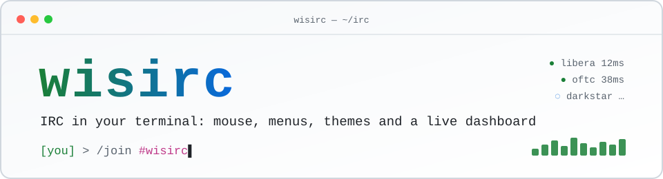
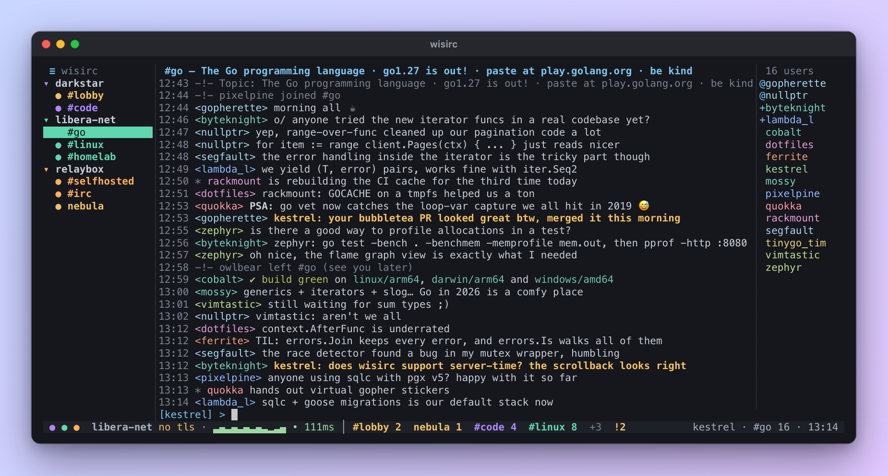
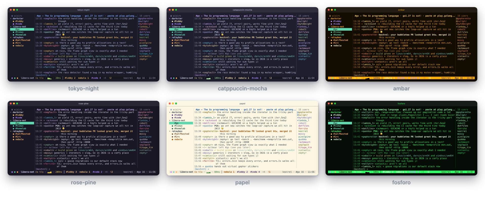
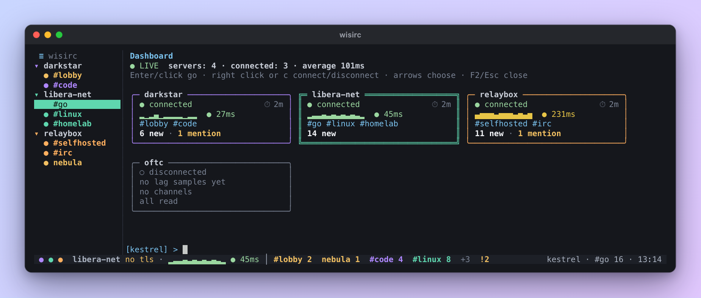
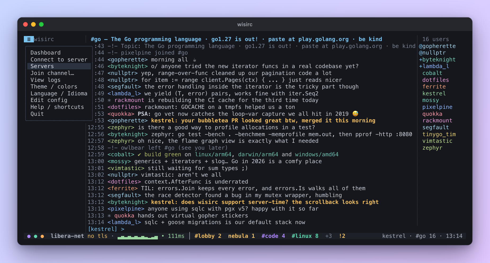
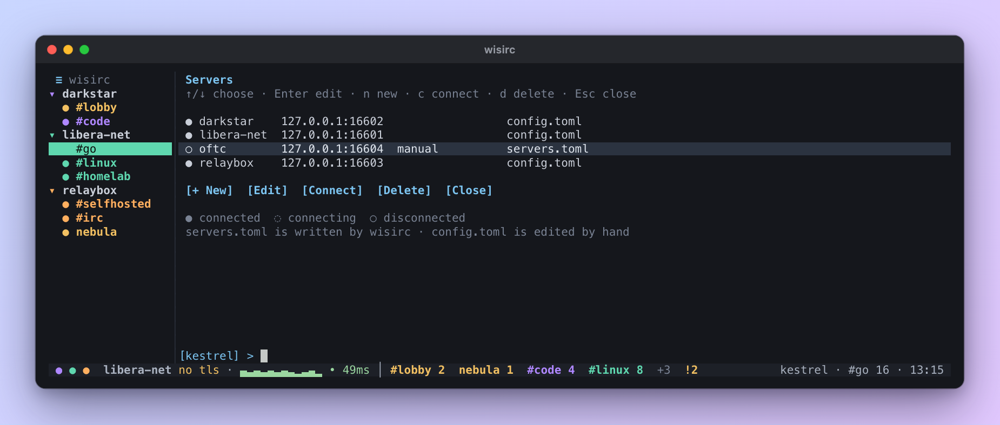
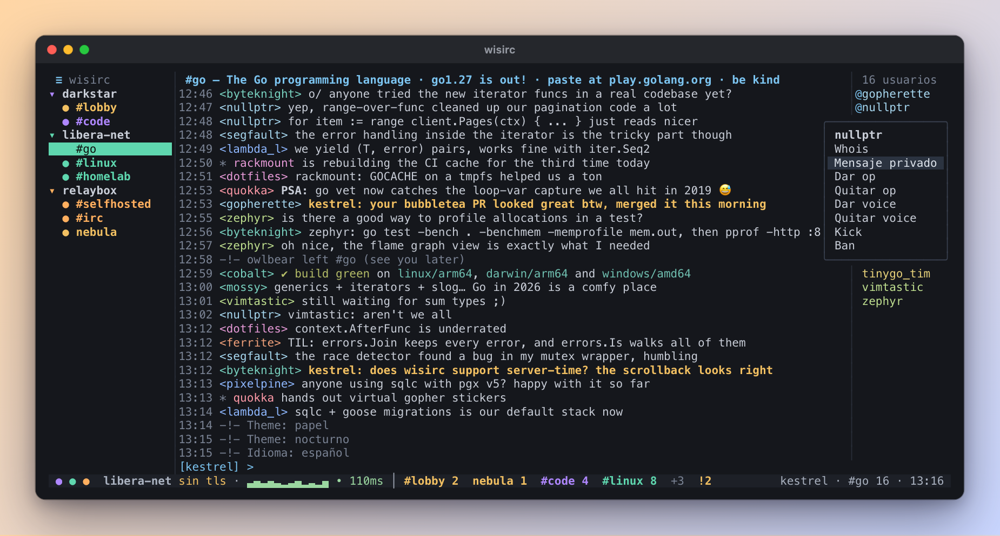

<p align="center">
  <picture>
    <source media="(prefers-color-scheme: dark)" srcset="docs/brand/banner-dark.svg">
    
  </picture>
</p>

<p align="center">
  <a href="https://github.com/eddyv73/wisirc/releases/latest"></a>
  <a href="https://github.com/eddyv73/wisirc/actions/workflows/ci.yml"></a>
  <a href="https://github.com/eddyv73/wisirc/actions/workflows/install.yml"></a>
  
  
  <a href="LICENSE"></a>
</p>

<p align="center"><a href="#instalación">Instalación</a> · <a href="#funciones">Funciones</a> · <a href="#temas">Temas</a> · <a href="#recorrido">Recorrido</a> · <a href="docs/guide.es.md">Guía</a> · <a href="README.md">English</a></p>

<p align="center">
  
</p>

**wisirc** es un cliente IRC para la terminal que se siente como una app de escritorio. Los servidores y canales viven en una barra lateral, el chat queda al centro y los usuarios a la derecha. Todo funciona con el mouse (clics, rueda, menús contextuales) y todo funciona con el teclado, al estilo irssi. Un solo binario, sin dependencias y sin necesidad de configurar nada para empezar.

## Instalación

```sh
curl -fsSL https://raw.githubusercontent.com/eddyv73/wisirc/main/install.sh | sh
```

Luego ejecuta `wisirc`. El instalador elige el binario para tu sistema (macOS o Linux, Intel o ARM), lo verifica con `SHA256SUMS`, lo deja en `~/.local/bin` y te avisa si esa carpeta no está en tu `PATH`. Ejecútalo otra vez para actualizar. Antes de que te llegue, cada versión se instala así en Linux y macOS de forma automática.

| Otras formas | Cómo |
|---|---|
| **Arch Linux / Garuda** | `makepkg -si` en [`packaging/aur`](packaging/aur), con man page y entrada en el menú (paquete en AUR próximamente) |
| **Go** | `go install github.com/eddyv73/wisirc/cmd/wisirc@latest` |
| **Binarios** | [último release](https://github.com/eddyv73/wisirc/releases/latest): `darwin-arm64`, `darwin-amd64`, `linux-amd64`, `linux-arm64` |
| **Desde el código** | `make build` (Go 1.27) |

<details>
<summary><b>Opciones del instalador</b></summary>

Las opciones van después de `sh -s --`:

```sh
curl -fsSL https://raw.githubusercontent.com/eddyv73/wisirc/main/install.sh | sh -s -- --version v0.3.1
curl -fsSL https://raw.githubusercontent.com/eddyv73/wisirc/main/install.sh | sh -s -- --add-to-path
curl -fsSL https://raw.githubusercontent.com/eddyv73/wisirc/main/install.sh | sh -s -- --source     # compilarlo tú (git + Go)
curl -fsSL https://raw.githubusercontent.com/eddyv73/wisirc/main/install.sh | sh -s -- --uninstall
```

| Opción / variable | Qué hace |
|---|---|
| `--version vX.Y.Z` | instala ese release en vez del último |
| `--source` | compila desde el código: este checkout o un clon nuevo |
| `--add-to-path` | agrega la carpeta de instalación a tu perfil (zsh, bash o fish), una sola vez |
| `--uninstall` | quita wisirc; tu configuración y tus logs se quedan |
| `WISIRC_PREFIX=/usr/local` | instala en otro lugar (`$WISIRC_PREFIX/bin`) |
| `WISIRC_REPO=dueño/nombre` | instala desde un fork |
| `GITHUB_TOKEN` | para un fork privado (o inicia sesión con `gh auth login`) |

Desde un clon, `./install.sh` acepta las mismas opciones.

</details>

<details>
<summary><b>Instalación manual y compilar desde el código</b></summary>

Descarga el binario para tu sistema desde `dist/` (o compílalo) y ponlo en tu `PATH`:

| Sistema | Binario |
|---|---|
| macOS Apple Silicon | `wisirc-darwin-arm64` |
| macOS Intel | `wisirc-darwin-amd64` |
| Linux x86-64 | `wisirc-linux-amd64` |
| Linux ARM64 | `wisirc-linux-arm64` |

```sh
install -m 0755 dist/wisirc-darwin-arm64 ~/.local/bin/wisirc
```

Compilar desde el código (requiere Go 1.27):

```sh
make build            # ./wisirc
make install          # copia a ~/.local/bin (PREFIX=/usr/local para otro destino)
make release VERSION=v0.1.0   # los 4 binarios en dist/
make test
```

</details>

## Primeros pasos

1. Ejecuta `wisirc`. Abre en el panel; presiona **Esc** para ir al chat.
2. Presiona **F1** (o haz clic en **≡**) para el menú principal: conectar, servidores, temas, idioma, ayuda.
3. Conéctate con `/connect irc.libera.chat -nick tunick -join #linux` y responde **Sí** cuando wisirc ofrezca guardarlo.
4. Cambia de canal con un clic o **Alt+1…9**; clic derecho en cualquier cosa para su menú.

## Funciones

<table>
<tr>
<td width="50%" valign="top">

**🖱️ Mouse y teclado, los dos completos**<br>
Clic en los canales, clic derecho en servidores, canales y nicks para sus menús, arrastra los bordes para cambiar el tamaño, selecciona texto para copiarlo. O no toques el mouse nunca.

</td>
<td width="50%" valign="top">

**📊 Panel en vivo**<br>
Una tarjeta por servidor con su estado, tiempo conectado, una gráfica animada de lag, los canales y los mensajes sin leer. Se abre al iniciar y con F2 cuando quieras.

</td>
</tr>
<tr>
<td valign="top">

**🎨 20 temas con vista previa**<br>
Dracula, Catppuccin, Tokyo Night, Rosé Pine, Kanagawa, monitores CRT verde y ámbar… todos revisados para que el texto se lea bien (WCAG AA). Cada servidor puede tener su propio color.

</td>
<td valign="top">

**🔐 Varios servidores, TLS y SASL**<br>
Conéctate a varias redes a la vez, con SASL PLAIN, contraseñas de servidor y de bouncer (ZNC) y certificados autofirmados cuando tú lo permites.

</td>
</tr>
<tr>
<td valign="top">

**🧭 Sin archivo de configuración**<br>
`/connect irc.libera.chat -nick tunick -join #linux` y guárdalo con un clic. Los servidores se administran desde una pantalla con formulario, y si usas Halloy importas todo en un clic.

</td>
<td valign="top">

**🌎 Español e inglés**<br>
Toda la interfaz sigue el idioma de tu sistema, y puedes cambiarlo en vivo desde el menú o con `/lang`.

</td>
</tr>
<tr>
<td valign="top">

**🔔 Menciones que te encuentran**<br>
Líneas resaltadas, canales marcados, un contador de menciones en la barra de estado y una notificación del sistema cuando no estás mirando.

</td>
<td valign="top">

**🗂️ Logs e historial**<br>
Un archivo por canal y por día; al abrir un canal vuelve su historial reciente, y el log completo está a un clic.

</td>
</tr>
</table>

## Temas

20 temas incluidos, con vista previa en vivo mientras recorres la lista (≡ → <b>Temas</b> o <code>/theme</code>). Todos mantienen el contraste del texto en WCAG AA, y cada servidor puede tener su propio color.

<p align="center">
  
</p>

## Recorrido

<table>
<tr>
<td width="50%" valign="top"><p align="center"><sub><b>Panel</b> · lag en vivo, tiempo conectado y mensajes sin leer por servidor (F2)</sub></p></td>
<td width="50%" valign="top"><p align="center"><sub><b>Menú ≡</b> · todo a un clic (F1)</sub></p></td>
</tr>
<tr>
<td width="50%" valign="top"><p align="center"><sub><b>Servidores</b> · conectar, editar, borrar o importar desde Halloy</sub></p></td>
<td width="50%" valign="top"><p align="center"><sub><b>Español</b> · toda la interfaz en español, y el menú de clic derecho de un nick</sub></p></td>
</tr>
</table>

Una grabación de 38 segundos está en <a href="docs/demo.cast"><code>docs/demo.cast</code></a> (<code>asciinema play docs/demo.cast</code>).

## Documentación

La <a href="docs/guide.es.md"><b>guía</b></a> lo cubre todo por tema, y <code>man wisirc</code> tiene la versión corta (en inglés).

<table>
<tr><td width="33%"><a href="docs/guide.es.md#atajos-de-teclado-y-comandos">⌨️ Atajos de teclado y comandos</a></td><td width="33%"><a href="docs/guide.es.md#mouse">🖱️ Mouse</a></td><td width="33%"><a href="docs/guide.es.md#conectarse-a-un-servidor">🔌 Conectarse a un servidor</a></td></tr>
<tr><td width="33%"><a href="docs/guide.es.md#pantalla-servidores">🗄️ Pantalla Servidores</a></td><td width="33%"><a href="docs/guide.es.md#venir-desde-halloy">📥 Venir desde Halloy</a></td><td width="33%"><a href="docs/guide.es.md#archivo-de-configuración">⚙️ Archivo de configuración</a></td></tr>
<tr><td width="33%"><a href="docs/guide.es.md#temas">🎨 Temas</a></td><td width="33%"><a href="docs/guide.es.md#colores-por-servidor">🌈 Colores por servidor</a></td><td width="33%"><a href="docs/guide.es.md#panel">📊 Panel</a></td></tr>
<tr><td width="33%"><a href="docs/guide.es.md#idioma">🌎 Idioma</a></td><td width="33%"><a href="docs/guide.es.md#logs-y-menciones">🗂️ Logs y menciones</a></td><td width="33%"></td></tr>
</table>

## Contribuir

Los issues y pull requests son bienvenidos: lee [CONTRIBUTING.md](CONTRIBUTING.md). Lo que cambió en cada versión está en [CHANGELOG.md](CHANGELOG.md).

## Licencia

[MIT](LICENSE) © 2026 eddyv73
