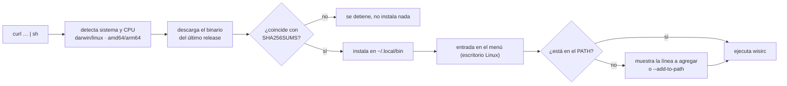

English: [README.md](README.md)

# wisirc

[](https://github.com/eddyv73/wisirc/actions/workflows/ci.yml) [](LICENSE)

Cliente IRC para terminal con ventanas al estilo herdr: barra lateral de servidores y canales, chat central y lista de usuarios. Se puede usar entero con el mouse (clic, rueda y menús contextuales) o entero con el teclado, igual que irssi.

```
┌≡─────────────┬────────────────────────────────┬──────────┐
│ ▾ irc.example.net   │ #lobby — topic del canal       │ @alice   │
│   ● #lobby   │ 12:01 <alice> hola             │ +ana     │
│     #otro    │ 12:02 <ana> qué tal alice      │  bob     │
│ ▸ libera     ├────────────────────────────────┴──────────┤
│              │ [alice] > _                               │
├──────────────┴───────────────────────────────────────────┤
│ irc.example.net: conectado · ▂▃▂▄▂ ● 40ms · 3 nuevas en #otro   │
└──────────────────────────────────────────────────────────┘
```

## Instalación

### Instalación rápida (macOS y Linux)

```sh
curl -fsSL https://raw.githubusercontent.com/eddyv73/wisirc/main/install.sh | sh
```

Y listo: ejecuta `wisirc`. El instalador detecta tu sistema y tu CPU, descarga el binario que corresponde del último release, lo verifica con `SHA256SUMS`, lo instala en `~/.local/bin`, agrega wisirc al menú de aplicaciones en escritorios Linux y, si esa carpeta no está en tu `PATH`, te dice la línea exacta que hay que agregar. Si lo vuelves a ejecutar, actualiza (`v0.3.0 → v0.3.1`). Todo el script se ejecuta desde su última línea, así que una descarga interrumpida nunca ejecuta la mitad.



Cada release se instala así automáticamente en Linux (x86-64 y ARM) y macOS, junto con actualizar, fijar una versión, `--add-to-path`, `--uninstall` y `--source` ([workflow de instalación](.github/workflows/install.yml)).

Las opciones van después de `sh -s --`:

```sh
curl -fsSL https://raw.githubusercontent.com/eddyv73/wisirc/main/install.sh | sh -s -- --version v0.3.1
curl -fsSL https://raw.githubusercontent.com/eddyv73/wisirc/main/install.sh | sh -s -- --add-to-path
curl -fsSL https://raw.githubusercontent.com/eddyv73/wisirc/main/install.sh | sh -s -- --source     # compilarlo tú (git + Go)
curl -fsSL https://raw.githubusercontent.com/eddyv73/wisirc/main/install.sh | sh -s -- --uninstall
```

| Opción / variable | Qué hace |
|---|---|
| `--version vX.Y.Z` | instala ese release en vez del último |
| `--source` | compila desde el código: este checkout o un clon nuevo |
| `--add-to-path` | agrega la carpeta de instalación a tu perfil (zsh, bash o fish), una sola vez |
| `--uninstall` | quita wisirc; tu configuración y tus logs se quedan |
| `WISIRC_PREFIX=/usr/local` | instala en otro lugar (`$WISIRC_PREFIX/bin`) |
| `WISIRC_REPO=dueño/nombre` | instala desde un fork |
| `GITHUB_TOKEN` | para un fork privado (o inicia sesión con `gh auth login`) |

Desde un clon, `./install.sh` acepta las mismas opciones.

### Arch Linux / Garuda (AUR)

```sh
yay -S wisirc      # o paru -S wisirc
```

El paquete compila desde el código del release e instala la página de manual (`man wisirc`) y un lanzador de escritorio.

### Con Go

```sh
go install github.com/eddyv73/wisirc/cmd/wisirc@latest
```

### Instalación manual

Descarga el binario para tu sistema desde `dist/` (o compílalo) y ponlo en tu `PATH`:

| Sistema | Binario |
|---|---|
| macOS Apple Silicon | `wisirc-darwin-arm64` |
| macOS Intel | `wisirc-darwin-amd64` |
| Linux x86-64 | `wisirc-linux-amd64` |
| Linux ARM64 | `wisirc-linux-arm64` |

```sh
install -m 0755 dist/wisirc-darwin-arm64 ~/.local/bin/wisirc
```

Compilar desde el código (requiere Go 1.27):

```sh
make build            # ./wisirc
make install          # copia a ~/.local/bin (PREFIX=/usr/local para otro destino)
make release VERSION=v0.1.0   # los 4 binarios en dist/
make test
```

## Idioma

La interfaz está en inglés y en español. Por defecto sigue el idioma del sistema (`LC_ALL`, luego `LC_MESSAGES`, luego `LANG`): por ejemplo, `LANG=es_MX.UTF-8` la pone en español y cualquier otro valor, en inglés.

Para cambiarlo, abre ≡ → **Language / Idioma**: al moverte con ↑/↓ ves el idioma en vivo, Enter lo deja puesto y Esc vuelve al anterior. También puedes escribir `/lang en` o `/lang es` (alias `/idioma` y `/language`). La elección se guarda en `~/.config/wisirc/prefs.toml`.

## Configuración

El archivo está en `~/.config/wisirc/config.toml` (respeta `$XDG_CONFIG_HOME`). Para usar otro: `wisirc --config <ruta>`. La primera vez que ejecutas wisirc se crea un ejemplo.

```toml
[servers.examplenet]
  nickname = "alice"
  username = "alice"
  server = "irc.example.net"
  port = 6697
  channels = ["#lobby"]
  dangerously_accept_invalid_certs = true   # solo para certificados autofirmados

  [servers.examplenet.sasl.plain]
  username = "alice"
  password = "hunter2"

[notifications]
  enabled = true

[theme]
  name = "oscuro"   # oscuro, claro, nocturno, clasico, alto-contraste, bosque, glaciar, papel, ...
```

Campos por servidor: `nickname`, `username`, `realname`, `server`, `port`, `use_tls` (por defecto activado en el puerto 6697), `channels`, `dangerously_accept_invalid_certs`, `password` (PASS del servidor), `sasl.plain` y `autoconnect`.

### Temas

≡ → **Tema / colores** abre un submenú con los temas; el actual lleva ●. Al moverte con ↑/↓ el tema se aplica en vivo; Enter lo deja puesto, Esc vuelve al anterior. Con el mouse, un clic en el tema lo aplica. También `/tema <nombre>` (o `/theme`), y `/tema` solo abre el submenú.

Los nombres de los temas son identificadores y no cambian con el idioma (`dark` y `light` se aceptan como alias de `oscuro` y `claro`).

| Tema | Estilo |
|---|---|
| `oscuro` | colores de tu terminal (el de siempre) |
| `claro` | para terminales de fondo claro |
| `nocturno` | carbón con acento cian, estilo herdr |
| `clasico` | homenaje a irssi, barra azul |
| `alto-contraste` | negro y blanco puros, accesible |
| `bosque` | oscuro cálido |
| `glaciar` | oscuro frío |
| `papel` | claro tipo papel |
| `dracula` | oscuro violáceo con acentos neón |
| `catppuccin-mocha` | oscuro pastel, malva y azul |
| `catppuccin-latte` | claro pastel |
| `tokyo-night` | azul marino con acentos eléctricos |
| `one-dark` | gris carbón estilo Atom |
| `solarized-oscuro` | azul petróleo, tonos Solarized |
| `rose-pine` | púrpura nocturno, rosa y dorado |
| `kanagawa` | tinta japonesa, tonos cálidos |
| `everforest` | verde bosque suave |
| `monokai` | oliva oscuro, colores vivos |
| `fosforo` | monitor CRT verde |
| `ambar` | monitor CRT ámbar |

Los colores de los esquemas conocidos se aclararon donde hacía falta para que todo el texto tenga un contraste de al menos 4.5:1 (WCAG AA); hay un test que lo comprueba. Los temas con fondo propio cambian el fondo de la terminal mientras wisirc está abierto y lo restauran al salir. El tema elegido en el menú se guarda en `~/.config/wisirc/prefs.toml` y gana sobre `[theme]` del config.

Las claves que wisirc no conoce (por ejemplo, de un config de halloy) se ignoran y aparecen como aviso. wisirc nunca modifica tu config. Si lo cambias desde **≡ → Editar config**, se abre `$EDITOR` y al cerrarlo se recarga el archivo y se conectan los servidores nuevos.

> La contraseña se guarda en texto plano. Protege el archivo con `chmod 600 ~/.config/wisirc/config.toml`.

## Colores por servidor

Cada servidor tiene su color en la barra lateral: la fila seleccionada se rellena con él, y la ▾ del servidor y sus canales se escriben en ese tono, así cada grupo se distingue de un vistazo. Por defecto los servidores reciben tonos de verde en el orden de la barra. Clic derecho en un servidor → **Color…** para elegir otro (verde, verde oscuro, lima, jade, cian, azul, morado, rosa, rojo, naranja, ámbar, amarillo, gris) o **Automático**; las flechas lo muestran en vivo, Enter lo deja y Esc lo deshace. Se guarda por servidor en `prefs.toml`. Los canales con mensajes sin leer van en negrita del color del servidor; las menciones mantienen el color de alerta del tema.

## Panel

wisirc arranca en el panel; Esc o F2 te lleva al chat. **F2** (o ≡ → **Panel**, o `/panel` / `/dashboard`) lo vuelve a abrir: una vista en vivo de todos tus servidores, una tarjeta por servidor:

```
 ● LIVE  servidores: 2 · conectados: 2 · promedio 120ms
 ╔═ znc ══════════════════════════╗ ╭─ libera ───────────────────────╮
 ║ ● conectado            ⏱ 2h 14m ║ │ ○ desconectado                 │
 ║ ▂▃▂▄▂▃▂  ● 42ms                ║ │ sin mediciones de latencia aún │
 ║ #lobby #code                   ║ │ sin canales                    │
 ║ 3 sin leer · 1 mención         ║ │ todo leído                     │
 ╚════════════════════════════════╝ ╰────────────────────────────────╯
```

Cada tarjeta muestra el estado, el tiempo conectado, un gráfico animado de latencia (verde/amarillo/rojo), los canales y los mensajes sin leer y menciones; el borde usa el color del servidor en la barra lateral. Mientras el panel está abierto, la latencia se mide cada 5 segundos en vez de cada 30. Clic en una tarjeta (o Enter) va a ese servidor; clic derecho (o `c`) lo conecta o desconecta; las flechas mueven entre tarjetas; F2 o Esc lo cierra.

## Mouse

| Acción | Resultado |
|---|---|
| Clic en **≡** | Menú principal (conectar, servidores, unirse a un canal, logs, tema, idioma, config, ayuda, salir) |
| Clic en un canal de la barra | Cambia a ese canal |
| Clic en ▾ / ▸ | Colapsa o expande un servidor |
| Clic derecho en un servidor | Conectar/Desconectar, Unirse a canal…, Color… |
| Clic derecho en un canal | Salir (part), Cerrar, Marcar como leído, Ver topic |
| Clic (o clic derecho) en un nick | Whois, Mensaje privado, Op/Voice, Kick, Ban |
| Arrastrar sobre el chat o un panel de ayuda | Selecciona y copia al portapapeles (pbcopy, wl-copy/xclip/xsel; por SSH, OSC 52) |
| Rueda | Desplaza el historial, la barra o la nicklist |
| Arrastrar un borde `│` | Cambia el ancho de la barra o de la nicklist |

## Atajos de teclado

| Tecla | Acción |
|---|---|
| `F1` | Menú principal |
| `Alt+1..9` | Ir al buffer N |
| `Ctrl+N` / `Ctrl+P` (o `Alt+→` / `Alt+←`) | Buffer siguiente / anterior |
| `Alt+A` | Siguiente buffer con actividad (primero las menciones) |
| `PgUp` / `PgDn` | Desplazar el historial |
| `↑` / `↓` | Historial de lo que escribiste |
| `Tab` | Completar nick |
| `Esc` | Cerrar menú o panel |
| `Ctrl+C` | Salir |

Comandos: `/join`, `/part`, `/msg`, `/query`, `/me`, `/nick`, `/whois`, `/topic`, `/kick`, `/ban`, `/mode`, `/quit`, `/connect`, `/close`, `/quote`, `/tema`, `/lang`, `/help`. Para enviar un texto que empieza por `/`, escribe `//`.

### Conectarse a un servidor nuevo

`/connect` (o `/conectar`) sin nada, o ≡ → *Conectar servidor*, abre una pantalla con ejemplos. Sintaxis:

```
/connect <nombre>                          servidor guardado en el config
/connect <host> [puerto] [opciones]
```

| Opción | Para qué |
|---|---|
| `-nick <nick>` | tu nick |
| `-user <usuario>` | usuario (en un BNC/ZNC: `usuario/red`) |
| `-pass <clave>` | clave del servidor o del BNC |
| `-sasl <usuario:clave>` | login SASL |
| `-join <#a,#b>` | canales al conectar |
| `-tls` / `-notls` | forzar TLS (por defecto solo en el puerto 6697) |
| `-insecure` | aceptar certificados inválidos |
| `-name <nombre>` | nombre en la barra lateral |

Ejemplos:

```
/connect 192.0.2.20 7000 -notls -nick pepe -user pepe/libera -pass miClaveZnc
/connect irc.libera.chat -nick pepe -sasl pepe:miClave123 -join #linux
/connect irc.ejemplo.org 6667 -nick pepe -pass claveDelServidor
```

Cuando el servidor responde, wisirc pregunta **¿Guardar &lt;nombre&gt; permanentemente?** (S/N o clic). Si dices que sí, se guarda en `~/.config/wisirc/servers.toml` y se conecta solo cada vez que abres wisirc.

### Venir desde Halloy en un clic

Si usas [Halloy](https://halloy.chat), wisirc encuentra su config (`~/Library/Application Support/halloy/config.toml` en macOS, `~/.config/halloy/config.toml` en Linux). En ≡ → **Servidores** aparece **[Importar de Halloy]** (o la tecla `i`): trae todos los servidores que aún no tienes, los guarda en `servers.toml` y los conecta. Los nombres que ya existen no se tocan.

Se importan nick, usuario, realname, host, puerto, TLS (en Halloy viene activado por defecto), certificados inválidos, canales, `password`, `password_file` y SASL PLAIN (también con `password_file`). Por seguridad `password_command` **no se ejecuta**; wisirc te avisa para que pongas esa clave a mano. `nick_password` y SASL EXTERNAL todavía no están soportados y también se avisan.

La primera vez que abres wisirc sin config, si hay un Halloy en el equipo, arranca directamente en esa pantalla.

### Pantalla Servidores

≡ → **Servidores** lista todos los servidores con su estado (● conectado, ◌ conectando, ○ desconectado) y de dónde vienen:

- `servers.toml`: los guarda wisirc. Se crean, editan y borran desde esta pantalla con un formulario (nombre, host, puerto, TLS, certificado inválido, nick, usuario `usuario/red` para BNC, clave, SASL, canales y *Conectar al iniciar*).
- `config.toml`: tu archivo a mano. *Editar* abre el editor; no se borran desde la pantalla, para no perder tus comentarios.
- `sin guardar`: conexiones hechas con `/connect`; se guardan con *Guardar*.

Botones: **[+ Nuevo]**, **[Editar]**, **[Conectar]** / **[Desconectar]**, **[Guardar]** (solo conexiones sin guardar), **[Borrar]**, **[Cerrar]** y, si hay un config de Halloy, **[Importar de Halloy]**.

Teclas: ↑/↓ elegir · Enter editar · `n` nuevo · `c` conectar/desconectar · `s` guardar · `d` borrar (pide confirmación) · `i` importar de Halloy · Esc cerrar. En el formulario: Tab/↓ siguiente campo, Espacio marca casillas, Enter guarda, Esc vuelve.

Si un nombre está en los dos archivos, gana `config.toml`. Con `autoconnect = false` un servidor queda guardado pero no se conecta al iniciar.

> En macOS Terminal.app o iTerm2, activa "Usar Option como Meta" para que funcionen los atajos con `Alt`.

## Logs

Se guarda un archivo por día y canal en `~/.local/share/wisirc/logs/<servidor>/<canal>/<AAAA-MM-DD>.log` (respeta `$XDG_DATA_HOME`). Al abrir un canal se cargan sus últimas 200 líneas como historial, y **≡ → Ver logs** muestra el registro completo del canal actual.

## Menciones

Cuando alguien escribe tu nick o te manda un privado, la línea se resalta y el canal se marca en la barra. Si no estás viendo ese canal, o la terminal no tiene el foco, también recibes una notificación del sistema: en macOS con `osascript` y en Linux con `notify-send`. Si no hay ninguno de los dos, suena la campana de la terminal.

## Contribuir

Los issues y pull requests son bienvenidos; lee [CONTRIBUTING.md](CONTRIBUTING.md) (en inglés). Los cambios de cada versión están en [CHANGELOG.md](CHANGELOG.md).

## Licencia

[MIT](LICENSE) © 2026 eddyv73

## Capturas


<table>
<tr>
<td width="50%"><br><sub><b>Panel</b> (F2): gráficas de lag en vivo, tiempo conectado, canales y mensajes sin leer por servidor</sub></td>
<td width="50%"><br><sub><b>Menú ≡</b> (F1 o clic): todo a un clic</sub></td>
</tr>
<tr>
<td><br><sub><b>Temas</b>: con las flechas se previsualizan en vivo (aquí catppuccin-mocha)</sub></td>
<td><br><sub>El tema claro <b>papel</b></sub></td>
</tr>
<tr>
<td><br><sub><b>≡ → Servidores</b>: conectar, editar, borrar, importar de Halloy</sub></td>
<td><br><sub>Formulario de servidor, pensado para BNC (<code>usuario/red</code>)</sub></td>
</tr>
<tr>
<td><br><sub><code>/connect</code> con ejemplos listos para adaptar</sub></td>
<td><br><sub>Interfaz en español (<code>/lang es</code>) y el menú de clic derecho de un nick</sub></td>
</tr>
</table>

### Demo

Una grabación de terminal de 38 segundos (panel, chat, menú, vista previa de temas en vivo, interfaz en español) está en [`docs/demo.cast`](docs/demo.cast). Reprodúcela en tu terminal con [asciinema](https://asciinema.org):

```sh
asciinema play docs/demo.cast
```

Se regenera con `docs/screenshots/tools/record-demo.sh` (servidores de prueba, nada real).
