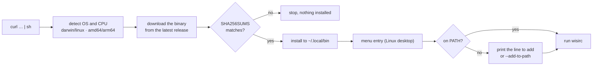
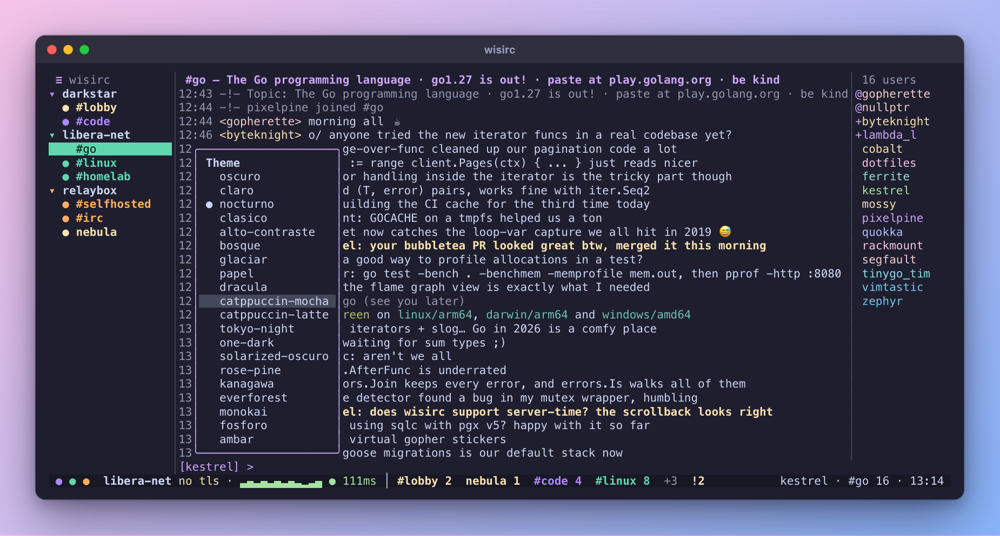
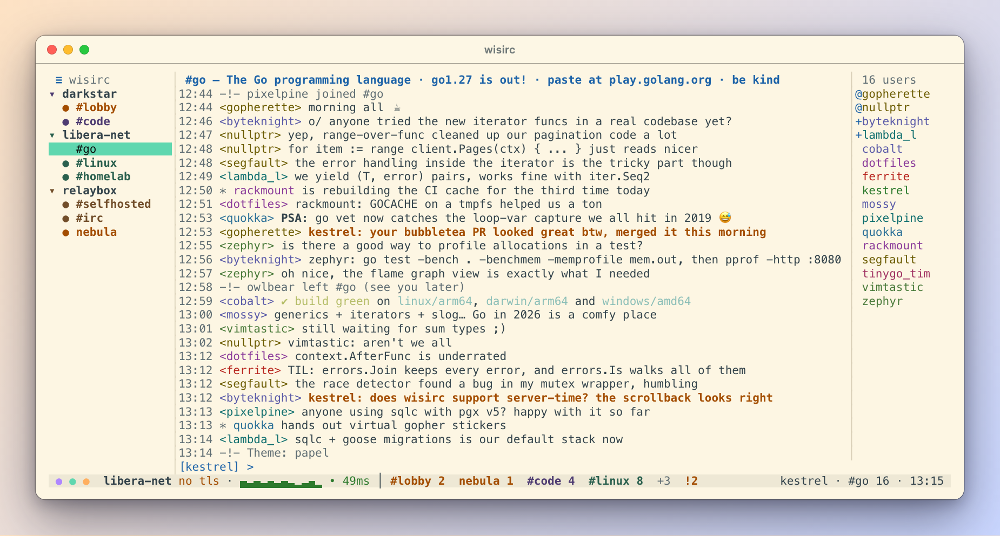
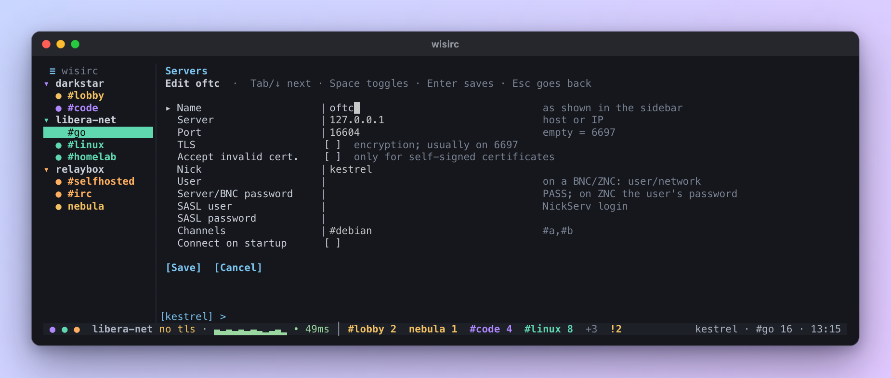
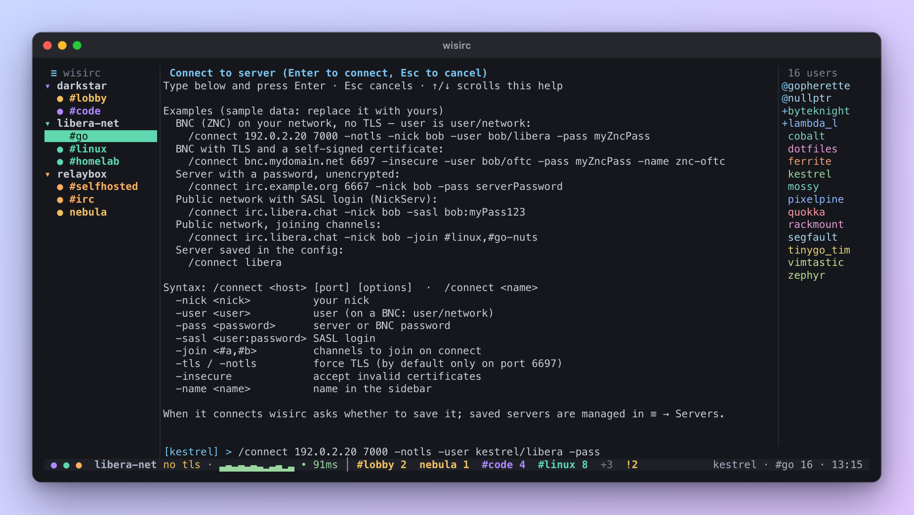

Español: [README.es.md](README.es.md)

# wisirc

[](https://github.com/eddyv73/wisirc/actions/workflows/ci.yml) [](LICENSE)

A terminal IRC client with herdr-style windows: a sidebar of servers and channels, the chat in the middle and the user list on the right. You can drive it entirely with the mouse (click, wheel and context menus) or entirely with the keyboard, just like irssi.

```
┌≡─────────────┬────────────────────────────────┬──────────┐
│ ▾ irc.example.net   │ #lobby — channel topic         │ @alice   │
│   ● #lobby   │ 12:01 <alice> hi               │ +ana     │
│     #other   │ 12:02 <ana> how's it going     │  bob     │
│ ▸ libera     ├────────────────────────────────┴──────────┤
│              │ [alice] > _                               │
├──────────────┴───────────────────────────────────────────┤
│ irc.example.net: connected · ▂▃▂▄▂ ● 40ms · 3 new in #other     │
└──────────────────────────────────────────────────────────┘
```

## Installation

### Quick install (macOS and Linux)

```sh
curl -fsSL https://raw.githubusercontent.com/eddyv73/wisirc/main/install.sh | sh
```

That's it: run `wisirc`. The installer detects your system and CPU, downloads the matching binary from the latest release, verifies it against `SHA256SUMS`, installs it into `~/.local/bin`, adds wisirc to the applications menu on Linux desktops, and tells you the exact line to add if that folder is not in your `PATH`. Running it again upgrades (`v0.3.0 → v0.3.1`). The whole script runs from its last line, so an interrupted download never executes half of it.



Every release is installed this way automatically on Linux (x86-64 and ARM) and macOS, together with upgrading, pinning a version, `--add-to-path`, `--uninstall` and `--source` ([install workflow](.github/workflows/install.yml)).

Options go after `sh -s --`:

```sh
curl -fsSL https://raw.githubusercontent.com/eddyv73/wisirc/main/install.sh | sh -s -- --version v0.3.1
curl -fsSL https://raw.githubusercontent.com/eddyv73/wisirc/main/install.sh | sh -s -- --add-to-path
curl -fsSL https://raw.githubusercontent.com/eddyv73/wisirc/main/install.sh | sh -s -- --source     # build it yourself (git + Go)
curl -fsSL https://raw.githubusercontent.com/eddyv73/wisirc/main/install.sh | sh -s -- --uninstall
```

| Option / variable | What it does |
|---|---|
| `--version vX.Y.Z` | install that release instead of the latest |
| `--source` | build from source: this checkout, or a fresh clone |
| `--add-to-path` | add the install folder to your shell profile (zsh, bash or fish), once |
| `--uninstall` | remove wisirc; your settings and logs stay |
| `WISIRC_PREFIX=/usr/local` | install into another place (`$WISIRC_PREFIX/bin`) |
| `WISIRC_REPO=owner/name` | install from a fork |
| `GITHUB_TOKEN` | for a private fork (or log in with `gh auth login`) |

From a clone, `./install.sh` takes the same options.

### Arch Linux / Garuda (AUR)

```sh
yay -S wisirc      # or paru -S wisirc
```

The package builds from the release source and installs the man page (`man wisirc`) and a desktop entry.

### With Go

```sh
go install github.com/eddyv73/wisirc/cmd/wisirc@latest
```

### Manual install

Download the binary for your system from the release (or `dist/` after `make release`) and put it on your `PATH`:

| System | Binary |
|---|---|
| macOS Apple Silicon | `wisirc-darwin-arm64` |
| macOS Intel | `wisirc-darwin-amd64` |
| Linux x86-64 | `wisirc-linux-amd64` |
| Linux ARM64 | `wisirc-linux-arm64` |

```sh
install -m 0755 dist/wisirc-darwin-arm64 ~/.local/bin/wisirc
```

Building from source (requires Go 1.27):

```sh
make build            # ./wisirc
make install          # copies to ~/.local/bin (PREFIX=/usr/local for another destination)
make release VERSION=v0.1.0   # the 4 binaries in dist/
make test
```

## Language

The interface is available in English and Spanish. By default it follows the system locale (`LC_ALL`, then `LC_MESSAGES`, then `LANG`): for example `LANG=es_MX.UTF-8` gives Spanish, and anything else gives English.

To change it, open ≡ → **Language / Idioma**: moving with ↑/↓ previews the language live, Enter keeps it and Esc reverts to the previous one. You can also type `/lang en` or `/lang es` (aliases `/idioma` and `/language`). The choice is stored in `~/.config/wisirc/prefs.toml`.

## Configuration

The file lives at `~/.config/wisirc/config.toml` (respects `$XDG_CONFIG_HOME`). To use a different one: `wisirc --config <path>`. An example is created the first time you run wisirc.

```toml
[servers.examplenet]
  nickname = "alice"
  username = "alice"
  server = "irc.example.net"
  port = 6697
  channels = ["#lobby"]
  dangerously_accept_invalid_certs = true   # only for self-signed certificates

  [servers.examplenet.sasl.plain]
  username = "alice"
  password = "hunter2"

[notifications]
  enabled = true

[theme]
  name = "oscuro"   # oscuro, claro, nocturno, clasico, alto-contraste, bosque, glaciar, papel, ...
```

Per-server fields: `nickname`, `username`, `realname`, `server`, `port`, `use_tls` (on by default on port 6697), `channels`, `dangerously_accept_invalid_certs`, `password` (server PASS), `sasl.plain` and `autoconnect`.

### Themes

≡ → **Theme / colors** opens a submenu with the themes; the current one is marked with ●. Moving with ↑/↓ applies the theme live; Enter keeps it, Esc goes back to the previous one. With the mouse, clicking a theme applies it. You can also use `/theme <name>` (or `/tema`), and `/theme` on its own opens the submenu.

Theme names are identifiers and stay the same in both languages (`dark` and `light` are accepted as aliases of `oscuro` and `claro`).

| Theme | Style |
|---|---|
| `oscuro` | your terminal's colors (the classic one) |
| `claro` | for light-background terminals |
| `nocturno` | charcoal with a cyan accent, herdr style |
| `clasico` | an irssi tribute, blue status bar |
| `alto-contraste` | pure black and white, accessible |
| `bosque` | warm dark |
| `glaciar` | cool dark |
| `papel` | paper-like light |
| `dracula` | violet dark with neon accents |
| `catppuccin-mocha` | pastel dark, mauve and blue |
| `catppuccin-latte` | pastel light |
| `tokyo-night` | navy blue with electric accents |
| `one-dark` | Atom-style charcoal gray |
| `solarized-oscuro` | petrol blue, Solarized tones |
| `rose-pine` | night purple, rose and gold |
| `kanagawa` | Japanese ink, warm tones |
| `everforest` | soft forest green |
| `monokai` | dark olive, vivid colors |
| `fosforo` | green CRT monitor |
| `ambar` | amber CRT monitor |

The colors of the well-known schemes were lightened where needed so that all text has a contrast of at least 4.5:1 (WCAG AA); a test checks this. Themes with their own background change the terminal background while wisirc is open and restore it on exit. The theme chosen from the menu is stored in `~/.config/wisirc/prefs.toml` and takes precedence over `[theme]` in the config.

Keys that wisirc does not know (for example, from a halloy config) are ignored and shown as a warning. wisirc never modifies your config. If you change it from **≡ → Edit config**, `$EDITOR` opens, and when you close it the file is reloaded and any new servers are connected.

> The password is stored in plain text. Protect the file with `chmod 600 ~/.config/wisirc/config.toml`.

## Server colors

Each server has its own color in the sidebar: the selected row is filled with it, and the server's ▾ and its channels are written in it, so every group is easy to tell apart. By default servers get shades of green in sidebar order. Right-click a server → **Color…** to pick another one (green, dark green, lime, jade, cyan, blue, purple, pink, red, orange, amber, yellow, gray) or **Automatic**; arrows preview it live, Enter keeps it, Esc reverts. The choice is stored per server in `prefs.toml`. Unread channels are bold in the server's color; mentions keep the theme's alert color.

## Dashboard

wisirc starts on the dashboard; Esc or F2 takes you to the chat. **F2** (or ≡ → **Dashboard**, or `/panel` / `/dashboard`) opens it again: a live overview of all your servers, one card each:

```
 ● LIVE  servers: 2 · connected: 2 · average 120ms
 ╔═ znc ══════════════════════════╗ ╭─ libera ───────────────────────╮
 ║ ● connected            ⏱ 2h 14m ║ │ ○ disconnected                 │
 ║ ▂▃▂▄▂▃▂  ● 42ms                ║ │ no lag samples yet             │
 ║ #lobby #code                   ║ │ no channels                    │
 ║ 3 new · 1 mention              ║ │ all read                       │
 ╚════════════════════════════════╝ ╰────────────────────────────────╯
```

Each card shows the connection state, uptime, an animated lag graph (green/yellow/red), joined channels and unread messages and mentions; card borders use the server's sidebar color. While the dashboard is open, lag is measured every 5 seconds instead of every 30. Click a card (or Enter) to go to that server; right click (or `c`) connects or disconnects it; arrows move between cards; F2 or Esc closes it.

## Mouse

| Action | Result |
|---|---|
| Click **≡** | Main menu (connect, servers, join a channel, logs, theme, language, config, help, quit) |
| Click a channel in the sidebar | Switches to that channel |
| Click ▾ / ▸ | Collapses or expands a server |
| Right-click a server | Connect/Disconnect, Join channel…, Color… |
| Right-click a channel | Leave (part), Close, Mark as read, View topic |
| Click (or right-click) a nick | Whois, Private message, Op/Voice, Kick, Ban |
| Drag over the chat or a help panel | Selects and copies to the clipboard (pbcopy, wl-copy/xclip/xsel; over SSH, OSC 52) |
| Wheel | Scrolls the history, the sidebar or the nicklist |
| Drag a `│` border | Changes the width of the sidebar or the nicklist |

## Keyboard shortcuts

| Key | Action |
|---|---|
| `F1` | Main menu |
| `Alt+1..9` | Go to buffer N |
| `Ctrl+N` / `Ctrl+P` (or `Alt+→` / `Alt+←`) | Next / previous buffer |
| `Alt+A` | Next buffer with activity (mentions first) |
| `PgUp` / `PgDn` | Scroll the history |
| `↑` / `↓` | History of what you typed |
| `Tab` | Complete nick |
| `Esc` | Close menu or panel |
| `Ctrl+C` | Quit |

Commands: `/join`, `/part`, `/msg`, `/query`, `/me`, `/nick`, `/whois`, `/topic`, `/kick`, `/ban`, `/mode`, `/quit`, `/connect`, `/close`, `/quote`, `/theme`, `/lang`, `/help`. To send text that starts with `/`, type `//`.

### Connecting to a new server

`/connect` (or `/conectar`) with no arguments, or ≡ → *Connect to server*, opens a screen with examples. Syntax:

```
/connect <name>                            server saved in the config
/connect <host> [port] [options]
```

| Option | Purpose |
|---|---|
| `-nick <nick>` | your nick |
| `-user <user>` | username (on a BNC/ZNC: `user/network`) |
| `-pass <password>` | server or BNC password |
| `-sasl <user:password>` | SASL login |
| `-join <#a,#b>` | channels to join on connect |
| `-tls` / `-notls` | force TLS on or off (by default only on port 6697) |
| `-insecure` | accept invalid certificates |
| `-name <name>` | name shown in the sidebar |

Examples:

```
/connect 192.0.2.20 7000 -notls -nick pepe -user pepe/libera -pass myZncPassword
/connect irc.libera.chat -nick pepe -sasl pepe:myPassword123 -join #linux
/connect irc.example.org 6667 -nick pepe -pass serverPassword
```

When the server answers, wisirc asks **Save &lt;name&gt; permanently?** (Y/N or click). If you say yes, it is saved to `~/.config/wisirc/servers.toml` and connects automatically every time you open wisirc.

### Coming from Halloy in one click

If you use [Halloy](https://halloy.chat), wisirc finds its config (`~/Library/Application Support/halloy/config.toml` on macOS, `~/.config/halloy/config.toml` on Linux). In ≡ → **Servers** an **[Import from Halloy]** button appears (or press `i`): it brings in every server you do not have yet, saves them to `servers.toml` and connects them. Names that already exist are left untouched.

Imported fields: nick, username, realname, host, port, TLS (on by default in Halloy), invalid certificates, channels, `password`, `password_file` and SASL PLAIN (also with `password_file`). For security, `password_command` is **not executed**; wisirc warns you so you can enter that password by hand. `nick_password` and SASL EXTERNAL are not supported yet and are reported as well.

The first time you open wisirc without a config, if there is a Halloy install on the machine, it starts straight on that screen.

### Servers screen

≡ → **Servers** lists every server with its state (● connected, ◌ connecting, ○ disconnected) and where it comes from:

- `servers.toml`: saved by wisirc. Servers are created, edited and deleted from this screen with a form (name, host, port, TLS, invalid certificate, nick, `user/network` username for a BNC, password, SASL, channels and *Connect on startup*).
- `config.toml`: your hand-written file. *Edit* opens the editor; these servers cannot be deleted from the screen, so your comments are never lost.
- unsaved: connections made with `/connect`; save them with *Save*.

Buttons: **[+ New]**, **[Edit]**, **[Connect]** / **[Disconnect]**, **[Save]** (unsaved connections only), **[Delete]**, **[Close]** and, when a Halloy config is found, **[Import from Halloy]**.

Keys: ↑/↓ choose · Enter edit · `n` new · `c` connect/disconnect · `s` save · `d` delete (asks for confirmation) · `i` import from Halloy · Esc close. In the form: Tab/↓ next field, Space toggles checkboxes, Enter saves, Esc goes back.

If a name is in both files, `config.toml` wins. With `autoconnect = false` a server stays saved but does not connect on startup.

> In macOS Terminal.app or iTerm2, enable "Use Option as Meta key" so the `Alt` shortcuts work.

## Logs

One file per day and channel is written to `~/.local/share/wisirc/logs/<server>/<channel>/<YYYY-MM-DD>.log` (respects `$XDG_DATA_HOME`). When you open a channel its last 200 lines are loaded as history, and **≡ → View logs** shows the full log of the current channel.

## Mentions

When someone writes your nick or sends you a private message, the line is highlighted and the channel is marked in the sidebar. If you are not looking at that channel, or the terminal does not have focus, you also get a system notification: on macOS through `osascript` and on Linux through `notify-send`. If neither is available, the terminal bell rings.

## Contributing

Issues and pull requests are welcome; see [CONTRIBUTING.md](CONTRIBUTING.md). Changes are listed in [CHANGELOG.md](CHANGELOG.md).

## License

[MIT](LICENSE) © 2026 eddyv73

## Screenshots


<table>
<tr>
<td width="50%"><br><sub><b>Dashboard</b> (F2): live lag graphs, uptime, channels and unread counts per server</sub></td>
<td width="50%"><br><sub><b>≡ menu</b> (F1 or click): everything is one click away</sub></td>
</tr>
<tr>
<td><br><sub><b>Themes</b>: arrows preview live (here catppuccin-mocha)</sub></td>
<td><br><sub>The light <b>papel</b> theme</sub></td>
</tr>
<tr>
<td><br><sub><b>≡ → Servers</b>: connect, edit, delete, import from Halloy</sub></td>
<td><br><sub>Server form, BNC friendly (<code>user/network</code>)</sub></td>
</tr>
<tr>
<td><br><sub><code>/connect</code> with ready-to-adapt examples</sub></td>
<td><br><sub>Spanish interface (<code>/lang es</code>) and a nick's right-click menu</sub></td>
</tr>
</table>

### Demo

A 38-second terminal recording (dashboard, chat, menu, live theme preview, Spanish UI) is in [`docs/demo.cast`](docs/demo.cast). Play it in your terminal with [asciinema](https://asciinema.org):

```sh
asciinema play docs/demo.cast
```

It is regenerated with `docs/screenshots/tools/record-demo.sh` (fake servers, nothing real).
